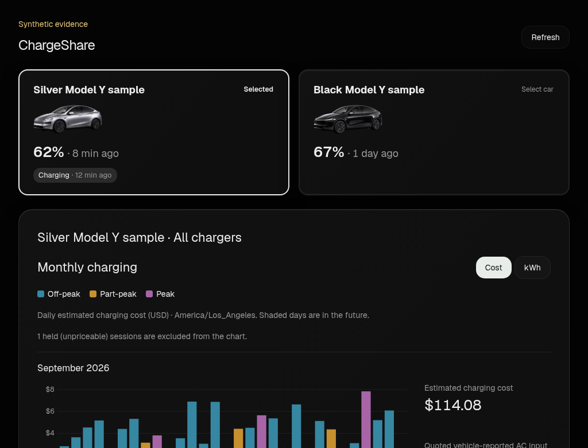
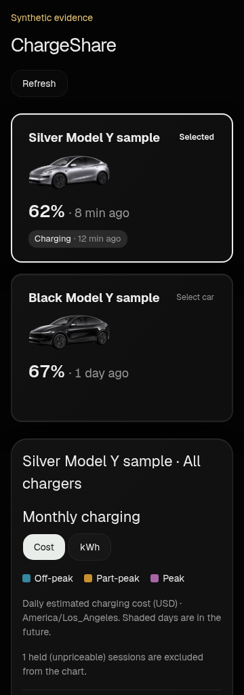

# ChargeShare

A Rust charging ledger for sharing a home charger, with a React/shadcn dashboard
for monthly energy and estimated cost. The local demo and screenshots use
synthetic telemetry and labeled public sample rates. An
[opt-in live adapter](docs/architecture.md#live-adapter) is also implemented;
vehicle and account setup remain separate.



<details>
<summary>Mobile preview (synthetic data)</summary>



</details>

## How it works

The [receiver-to-dashboard flow](docs/architecture.md#architecture-at-a-glance):

```text
Tesla Fleet Telemetry -> official receiver -> Kafka -> ingestion (Rust)
  -> SQLite (retained normalized events) -> rebuilt sessions + geofence match
  -> configured time-of-use pricing -> dashboard
```

SQLite retains normalized source events; Rust [rebuilds sessions](crates/chargeshare-ingestion/src/replay.rs)
from that evidence and applies [shared-charger location geofence matching](docs/architecture.md#durable-ingestion-and-recovery).
The [live adapter](docs/architecture.md#live-adapter) retains location classifications
and discards raw payloads and coordinates before storage.

Eligible sessions are [priced in Rust](docs/architecture.md#persisted-time-of-use-pricing)
with configured time-of-use rates, such as the labeled PG&E EV2-A sample in
`America/Los_Angeles`. Allocation of counter energy across rate periods is
estimated using elapsed UTC time.

The [dashboard](apps/web/src/components/monthly-charging.tsx) shows monthly D3 daily
stacked bars for Off-peak, Part-peak and Peak, a cost/kWh toggle and day details.
Only quoted shared-charger energy contributes to totals; held sessions are
excluded with a notice, and partial coverage is flagged.

[Energy is vehicle-reported AC input](docs/architecture.md#measurement-boundary),
with unvalidated physical accuracy. Costs are energy-only estimates excluding
fees and taxes, not bills.

## Quickstart

Use Linux x86_64 or aarch64 with **Nix** (`nix-command` and `flakes` enabled) and a running
local **Docker** daemon your user can access. Nix supplies the pinned development
tools; it does not install or start Docker. Remote Docker contexts are refused.
Run from the repository root; first startup can take several minutes.

```sh
nix develop --no-update-lock-file -c bash scripts/dev/poc.sh up
```

Open the [persisted dashboard](docs/architecture.md#ports-and-boundaries) on local
port **5174**. Startup sends no fixtures, so a fresh dataset is empty. Populate
and check the receiver → Kafka → SQLite → HTTP path:

```sh
nix develop --no-update-lock-file -c bash scripts/dev/poc.sh check
```

Select a fictional car card to see its all-charger results. Each card shows
its configured color, latest valid battery percentage and relative age, including
reports before a charging session exists. The age updates between refreshes;
readings remain visible after days without telemetry or a failed fetch.
“Unavailable” means no valid reading has been reported. A Charging badge shows
explicit charge-state telemetry with its own age; a newer battery report does
not refresh that state. Month selection does not affect these readings.
On live startup, legacy signals missing their battery field are enriched from
retained Kafka records before the API starts, including recovered cars and
SOC-only reports outside sessions. Interrupted passes safely retry without
changing sessions, energy, pricing or ordinary offsets. Expired readings remain
unknown; completed passes are skipped on later startups.
Silver-like and dark colors use Tesla Model Y image cutouts; other colors use a tinted
traced silhouette ([artwork credits](apps/web/public/cars/CREDITS.md)).
Artwork fits within 120 × 60 px while preserving its proportions.
Bars default to estimated cost; switch to kWh and hover, tap or select a day for
its breakdown.
Configuration, sample-rate provenance and session quality details are below the chart.

Restart or stop while preserving evidence:

```sh
nix develop --no-update-lock-file -c bash scripts/dev/poc.sh restart
nix develop --no-update-lock-file -c bash scripts/dev/poc.sh down
```

After stopping, explicitly discard only this checkout's synthetic runtime and
broker volume (the next `up` creates an empty dataset):

```sh
nix develop --no-update-lock-file -c bash scripts/dev/poc.sh reset --confirm-synthetic-reset
```

Without the confirmation flag, `reset` lists its scope and refuses deletion.
The independent fixture preview uses local port **5173** while the stack runs.

### Screenshot dataset without Docker

[The deterministic generator](dev/fixtures/dashboard.py) creates June–September
2026 charging history for named fictional Model Y cars, silver and
black card colors with distinct current battery values, and named
driveway and garage chargers, using existing fictional coordinates and labeled
public sample rates.
**Synthetic data for demos and screenshots only; not real.**

With the Rust/Node tools and web dependencies installed, run from the repository
root. Use a fresh output directory for each export:

```sh
python3 dev/fixtures/dashboard.py > /tmp/chargeshare-dashboard-input.json
cargo run --locked -p chargeshare-ingestion --example dashboard-fixture -- /tmp/chargeshare-dashboard-input.json /tmp/chargeshare-dashboard-demo
python3 dev/fixtures/dashboard.py --serve /tmp/chargeshare-dashboard-demo/http
```

In a second terminal, run `npm --prefix apps/web run dev:persisted` and open local
port **5174**. The Rust example ingests decoded fictional records into SQLite and
exports the persisted dashboard's usual JSON, with monthly history calculated as
of September 30, 2026. The default fixture includes a fresh battery reading and
an independently dated Charging state on the silver car, plus an older reading
on the black car. Use `--battery-example old` or `--battery-example never` on the
generator for stale and never-reported examples. Relative ages use the browser
clock, so this fixed snapshot naturally ages after its fixture date. The HTTP
server serves only that snapshot; receiver/Kafka transport is not exercised. Generated data and SQLite stay under `/tmp`, outside
the checkout. The silver/black and battery mappings are fixture-only.

To include the plain-shape synthetic private-image examples used in the README
screenshots, generate both optional images before serving:

```sh
python3 dev/fixtures/dashboard.py --write-placeholder-images /tmp/chargeshare-dashboard-demo/http/api/poc/car-images
```

### Optional private car images

Keep runtime settings and image files outside the checkout. Add this optional
member to the existing private settings JSON, then restart the owning runtime:

```json
{ "private_car_images_dir": "/tmp/chargeshare-private-images" }
```

For a synthetic setup example, create that directory with:

```sh
python3 dev/fixtures/dashboard.py --write-placeholder-images /tmp/chargeshare-private-images
```

Match the registry paint color exactly: remove `#`, lowercase its six hex digits,
and append `.png`. For example, `#B8BDC3` uses `b8bdc3.png`. Only PNG is supported,
up to 2 MiB and 4096 × 4096 pixels. The existing dashboard backend serves these
images without disclosing filesystem paths. Missing, unreadable, unsupported,
oversized or browser-undecodable images use the existing CC0 artwork. Symlinks
in the directory path or image file are refused, and no directory listing is
provided. Omitting the setting preserves existing behavior; changing it does not
change the fixed ledger settings or require a database migration. Use only the
generated plain shapes in tests, documentation and public screenshots. Private
manufacturer images must stay outside Git, public builds and public evidence.

### Live registry migration and car commands

Fixed runtime settings select Kafka/source, database, API port and immutable rate
model definitions. Live cars, display names, charger geofences, charger ownership,
rate selections and assignments belong to the SQLite registry. The legacy
`mappings` and `shared_charger` sections are bootstrap input only.

`live` startup builds a missing registry automatically from the legacy sections,
then applies charger-rate and car-color migrations in order through schema six.
Existing schema-four/five registries upgrade without legacy config. The synthetic
[example config](dev/live-config.example.json) shows optional `registry_setup`
names and charger owner; omitted fields use the
[registry defaults](docs/architecture.md#live-registry-and-retained-recovery).
To name things explicitly instead, while the ingestion owner is stopped, preserve
a private database/source-marker backup and run the setup script against the
existing private database:

```sh
python3 scripts/dev/registry_setup.py --database "<private-database>" \
  --bootstrap "<private-legacy-input>" --car-name "vehicle-a=Car A" \
  --charger-name "Charger A" --charger-owner owner-a
cargo build --locked -p chargeshare-ingestion --bin chargie
chargie car add --database "<private-database>" \
  --vin "<vin>" --vehicle vehicle-b --owner owner-b \
  --name "Model Y" --make Tesla --model "Model Y" --charger "<existing-charger-id>"
chargie car rename --database "<private-database>" --vehicle vehicle-b --name "Neighbor's Model Y"
chargie car set-color --database "<private-database>" --vehicle vehicle-b --color '#16181C'
chargie car remove --database "<private-database>" --vehicle vehicle-b
```

Use the built `target/debug/chargie` executable, or its installed path. Declare the
charger's actual owner explicitly; it does not determine a car's ledger owner.
Repeat `--charger` for multiple assignments. Adding a car stores a durable recovery
request; restart with the fixed settings to scan the captured retained Kafka
range for that car. Ordinary progress and previous cars are preserved. Seven-day
retention does not guarantee seven complete days. The new car becomes selectable
after recovery and handoff complete. Rename updates only the display name; remove
hides a car while preserving its history and continuing telemetry ingestion.
Car colors accept exactly `#RRGGBB`; existing and new cars default to neutral gray
(`#808080`). Startup automatically migrates registry schema five to six under
the ownership lock and a transaction, preserving evidence and charger rate
assignments. Set colors while ingestion is stopped, then restart.
With no active cars the dashboard shows an empty state. No Pi or live database
access is required for repository tests; private migration is a separate operator
action. See the [registry contract](docs/architecture.md#live-registry-and-retained-recovery).

## Tests

Enter the pinned shell, then run the applicable checks:

```sh
nix develop --no-update-lock-file
cargo fmt --all -- --check
cargo clippy --workspace --all-targets --locked -- -D warnings
bash scripts/testing/offline-suite.sh
bash scripts/testing/ingestion-suite.sh
python3 scripts/testing/test_ingestion_guard.py
python3 -m unittest discover -s scripts/dev -p 'test_*.py'
python3 -m unittest discover -s dev/fixtures -p 'test_*.py'
npm --prefix apps/web ci
npm --prefix apps/web run lint
npm --prefix apps/web test
npm run preview:build
npm --prefix apps/web run build:persisted
node scripts/security/check-paths.mjs
```

Both Rust suite wrappers run `cargo test --workspace --locked` and guard against
missing or filtered acceptance suites. For full receiver/recovery/viewing
acceptance, use a fresh, stopped runtime with no retained state:

```sh
nix develop --no-update-lock-file -c bash scripts/dev/acceptance.sh all
```

CI runs [repository checks](.github/workflows/security.yml),
[receiver transport](.github/workflows/telemetry-integration.yml) and
[ingestion/viewing acceptance](.github/workflows/ingestion-acceptance.yml).
Read [SECURITY.md](SECURITY.md) for scanner/hook setup and publication checks;
record run results in the owning GitHub issue or PR.

## Documentation

- [Architecture](docs/architecture.md): components, data flow, ports, domain contracts and decisions.
- [Pricing](docs/architecture.md#persisted-time-of-use-pricing): configured sample rates, local-time allocation and estimate boundaries.
- [Code design](docs/code-design.md): design-phase guidance for cohesive Rust modules and inward dependencies.
- [Workflow](docs/workflow.md): how each feature goes from issue to merged PR.

Contributors follow [AGENTS.md](AGENTS.md). Original code and documentation are
[MIT licensed](LICENSE); [upstream notices](docs/licenses/) remain applicable.
