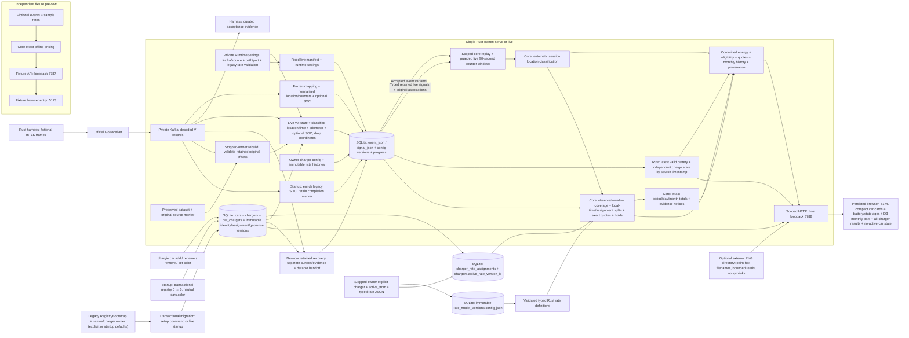

# Architecture and domain contract

ChargeShare provides exact offline pricing, a synthetic local receiver/Kafka
harness, durable Rust ingestion, a scoped browser view and an opt-in live adapter.
Ingestion, persisted viewing, automatic location classification and derived
time-of-use pricing are implemented. No live vehicle, account or production
service is connected. Setup and checks are in [README](../README.md); contributor
rules are in [AGENTS](../AGENTS.md) and [code design](code-design.md).

## Components

| Component | Responsibility |
| --- | --- |
| `chargeshare-core` | Rust domain: scoped replay, exact energy/money and local-time sample pricing and monthly charging aggregation |
| `chargeshare-ingestion` | Synthetic normalization and live state adaptation, Kafka consumption, SQLite transactions/recovery and committed scoped HTTP results |
| `chargeshare-harness` | Rust sender/verifier for finite fictional receiver traffic; requires protocol ACKs and matching new Kafka records |
| `chargeshare-preview` | Independent Rust fixture API with core-calculated sample prices |
| `apps/web` | React/TypeScript and shadcn; separate persisted and fixture entries/bundles; D3 scale/shape modules for daily stacked bars |
| External receiver and Kafka | Pinned official Go Fleet Telemetry receiver and private single-broker synthetic transport |
| `scripts/dev` and Tilt | Owned startup, readiness, source epochs, finite acceptance, shutdown and explicit reset |

Domain dependencies point inward to the core. Receiver decoding, SQL, HTTP and
UI formatting stay outside it; money calculations stay in Rust. The official
receiver remains external Go code, with immutable inputs in
[`dev/upstream-pins.json`](../dev/upstream-pins.json).

## Architecture at a glance

Arrows show evidence/result flow. Solid arrows describe implemented paths.



One long-lived ingestion process owns one SQLite Store. It ingests and commits,
then serves requests between transactions. Each response replays one committed
snapshot; summary and session details agree. HTTP requests never reopen the
database. Bounded CLI consumers/replayers are for use while this owner is stopped,
and concurrent writers are refused.

## Ports and boundaries

All published application listeners bind IPv4 host loopback. Synthetic Kafka has
no host listener; live mode connects to an already configured broker.

| Endpoint | Boundary |
| --- | --- |
| `http://127.0.0.1:5174` | Persisted dashboard; Vite proxies only `/api/poc` to 8788 |
| `http://127.0.0.1:8788` | Sole ingestion owner's scoped results/readiness API |
| `http://127.0.0.1:5173` | Independent fixture dashboard |
| `http://127.0.0.1:8787/api/demo` | Fixture-only Rust API |
| `https://127.0.0.1:8443` | Receiver mTLS transport; container port 4443 |
| `http://127.0.0.1:10350` | Tilt resource UI |
| `kafka:9092` | Private Compose network only |

The owner binds `0.0.0.0:8788` only inside the reviewed private container, published
as host `127.0.0.1:8788`. It runs as the current user with a read-only binary,
libraries and container filesystem; only owned `.local-runtime/` is writable.
The Compose bridge and synthetic owner/vehicle checks are development boundaries,
not production authentication or permission for cross-owner sharing.

`GET /api/poc/owners/{owner}/vehicles/{vehicle}/results` requires a configured
pair of validated aliases. Malformed scopes return 400, unknown/mismatched scopes
404, unsupported methods 405, and unavailable results 503. Errors never echo
rejected values. `/api/poc/ready` reports readiness separately from acceptance.
`GET /api/poc/scopes` returns active, recovered car aliases, display names and
linked charger IDs/names with a `synthetic_only` flag. Historical scoped reads
remain available for inactive cars. The browser discovers these choices before requesting
results; failed discovery clears the available view and retries on refresh.
There are no aggregate, mutation or pricing endpoints in this API.

Optional `RuntimeSettings.private_car_images_dir` is display configuration, excluded
from the stored fixed-settings contract; existing registries need no migration.
The viewing adapter pins an external absolute directory with descriptor-relative
opens, refusing symlinks in every component and image filename. It serves only
`GET /api/poc/car-images/{six-lowercase-hex-digits}.png`, matching registry paint
`#RRGGBB` without `#`. Files must be regular readable PNGs no larger than 2 MiB,
with bounded dimensions of 4096 × 4096 and PNG header/end markers. Reads remain
bounded if files grow. Nonblocking opens refuse special files without waiting.
Responses use `image/png`, `nosniff` and `no-store`; unavailable images return a
fixed path-free error. Directory listings, arbitrary paths and image metadata
endpoints are absent. The browser falls back on missing or undecodable images to
the existing color-selected CC0 artwork. Thumbnails fit 120 × 60 px using
`object-fit: contain`; battery and independent charge-state freshness retain
their existing semantics. The selected car always requests all-charger results;
backend charger-filter compatibility and Rust pricing remain unchanged.

Responses contain aliases, exact six-decimal observed/eligible/priced kWh, sessions,
exact quotes and once-rounded scoped subtotals, quality/exclusion and rate-hold
reasons, mode-specific measurement labels and explicit estimate boundaries, allowlisted rate/time provenance
and a deterministic semantic revision. Revisions reflect visible domain results, the local calendar day
and provenance, not requests or redelivery; they are not cryptographic tokens.
No coordinates, raw payload, device identity, credentials, paths, offsets or logs
are served. Session results include `SharedCharger`, `OtherCharger` or `Held` and
`InsideGeofence`, `OutsideGeofence`, `LocationUnavailable` or `LocationAmbiguous`.
The overall state is empty, eligible when every session is eligible, or held when
any session remains held or excluded. Synthetic result provenance identifies the loaded geofence version; live
sessions identify the applicable immutable charger/assignment/geofence versions; classification reasons are separate from evidence quality.

The existing results response includes `monthly` history derived in the core
from the same scoped committed quotes, without new persistence, repricing or
energy reallocation. The adapter supplies the current UTC clock instant; the
core resolves `today` in `America/Los_Angeles`. The current month comes first,
followed by months with dated retained evidence, newest first. Each month returns
calendar bounds and every calendar day, including empty and marked future days.
Ordered Off-peak, Part-peak and Peak totals retain six-decimal kWh and exact USD;
each period/day/month display cost rounds its exact subtotal once. Only quoted
shared-charger slices contribute energy/cost. Totals are absent when no quotes
exist; quoted zero energy keeps an explicit zero total. Evidence counts and
quality flags distinguish held, other-charger, partial and complete-zero evidence.
Quoted partial evidence marks only the observed slice days. Unquoted and zero
sessions use available connection/counter bounds for calendar placement, with
half-open connection spans; undated evidence has a separate count. Session
responses expose available UTC start/end bounds in both modes. Counts represent
unique sessions within each day/month, so a crossing session can appear in
multiple calendar summaries. `results-v2` revisions include these additions and
advance on a local calendar rollover; replay provenance is `scoped-core-replay-v3`.
Live semantic revisions additionally include the `live-counter-window-v1`
calculation contract, preserving the existing response format and offline revisions.

D3's `d3-scale` and `d3-shape` position the browser's daily stacks using returned
exact totals converted to numbers only for geometry. Bars toggle between
estimated cost and kWh, defaulting to cost. Hover, tap and keyboard selection
share one returned day breakdown; a full-width day selector provides larger
phone targets. Monthly totals sit alongside charts on desktop and below them
on narrow screens. Held sessions are excluded with a small notice, and
other-charger energy remains excluded. Scope changes clear charts and selected
days while preserving refresh, timeout and unavailable/refused behavior.
Configuration exposes only the charger label, rate plan, effective dates,
timezone, period rates and public sample source. Session quality and pricing
information remain reachable; connection IDs, semantic revisions, source epochs,
internal version dumps and geofence configuration are hidden in the owner view.
No geofence radius/center fields are added.

The persisted UI separates empty, complete zero, incomplete/held, refused and
unavailable states. Scope changes hide prior results; failed reads clear them.
It presents returned exact cost, display amount, rate and interval strings without
browser money arithmetic. It never falls back to fixture data or claims an amount
owed. A missing quote has no fabricated zero subtotal; a complete eligible zero
session has a zero quote. Rate-held counts and reasons remain visible. Browser
requests time out after five seconds and repeat every ten seconds.
Broker/source/storage failures latch the owner unavailable until repaired and
restarted. HTTP reads/writes and broker verification have bounded deadlines.

## Durable ingestion and recovery

[`dev/fixtures/`](../dev/fixtures/) contains finite fictional binary
frames, exact ACK bytes and expected decoded Kafka multisets for complete,
missing, duplicate and reordered traffic. Frames use official helpers from the
pinned receiver revision; names and battery readings remain fixture context.
The verifier takes starting offsets before sending, so retained traffic cannot
satisfy a fresh run. ACK alone never proves the downstream result. After matching
observed records, the harness retains curated normalized evidence for complete
sessions using the ingestion normalizer, preserving one field-validation policy.
Its publication summaries omit location fields, and replay metadata
contains scenario identity, counts and starting offsets rather than raw payloads.

[`dev/ingestion-manifest.json`](../dev/ingestion-manifest.json) freezes fictional
device/owner/vehicle associations and maps observed source moments to explicit
Start/Sample/End, connection, position and AC annotations. An annotation creates
no event without its observed record and contains no expected energy counter.
Charging-complete state and silence never invent an End.

The versioned normalizer accepts `VehicleName`, `BatteryLevel`,
`DetailedChargeState`, `ACChargingEnergyIn` and `Location` in the inspected V envelope.
Names and battery values are discarded; counters come only from observed strings.
Missing counters remain absent, invalid counters retain safe reasons, and
unsupported/duplicate fields reject safely. Integral UTC `createdAt` becomes
signed Unix seconds; Kafka's zero timestamp header is not event time. Mapping,
input, normalizer and time-conversion versions are frozen with the database.
`Location.locationValue` supplies latitude and longitude. Finite coordinates in
latitude ±90° and longitude ±180° are normalized to canonical decimal strings
with signed zero removed. Malformed, duplicate-coordinate, out-of-range and invalid
location values retain only an invalid state; missing location stays absent.
Other receiver fields remain strictly allowlisted. Raw location payloads and
rejected coordinate text are discarded. Diagnostics redact points, and coordinates
never enter API responses, browser bundles, application logs or acceptance output.

The synthetic manifest configures an owner charger with a stable charger ID, synthetic
geofence and selected rate-version IDs. Vehicle registration selects its owner
and that owner's charger; shared physical charger IDs and rate histories do not
merge owner ledgers. Geofences remain owner-scoped under a separate geofence
version. Legacy geofence-only manifests remain readable with no selected rates.
The Rust core uses great-circle haversine distance on a sphere with mean radius
6,371,008.8 m. The radius is inclusive, with a 10 nm numerical rounding allowance;
this computation makes no claim about physical positioning accuracy.
Every retained logical session position contributes location evidence. All inside
means `SharedCharger`; all outside means `OtherCharger`. No valid samples means
`Held` / `LocationUnavailable`; partial coverage, mixed locations or conflicting
evidence means `Held` / `LocationAmbiguous`. A later valid sample can enrich the
same otherwise-identical missing/invalid event without duplicating energy or
boundaries. Distinct valid points at the same position remain conflicts.

Classification is derived on replay, without stored per-session decisions,
review controls, overrides or a classify API. Loading a new geofence version on
owner startup automatically replays every affected retained session using that
config. Previously loaded versions retain immutable normalized config; changing
content under a reused version refuses recovery. Geofence and charger/rate
selection can change
through startup configuration; source bindings, mappings, annotations and
normalization/time contracts stay frozen. Schema-one and schema-two datasets
migrate transactionally to schema three without removing evidence or progress.
Absent locations yield an automatic hold.

SQLite stores curated variants or fixed rejection reasons, provenance and next
partition positions in one transaction using WAL, FULL synchronization, foreign
keys and a bounded busy timeout. Exact counters and unsigned positions use
canonical decimal TEXT. Arbitrary raw JSON and rejected text are not stored.
SQLite is the sole recovery-position authority; automatic Kafka commits and
offset storage are disabled. Rollback changes neither evidence nor progress;
interrupted commits recover consistent old-or-new state. Redelivery is idempotent,
while conflicting domain variants are preserved for conservative core replay.

An owned Kafka volume label and private `source-epoch.json` bind the dataset to
its epoch, topic, cluster, partition and initial offset. Ordinary restart/down
preserve the pair and SQLite. Missing/mismatched identity, frozen configuration
changes or retained-offset gaps refuse recovery, preserving evidence. Recovery
never seeks latest or silently resets. Bounded reread checks already committed,
still-retained ranges without changing evidence or progress.

`poc.sh up` starts services without sending fixtures; `check` sends fresh traffic
and checks Kafka, committed SQLite, scoped HTTP and the browser entry. Lifecycle
commands serialize under a private lock. Only confirmed reset of stopped, owned
synthetic state removes the runtime and broker volume; it never prunes Docker.
The shared `scripts/dev/acceptance.sh all` owns its fresh runtime and teardown and
refuses preexisting state. It checks transport, recovery, reread, refusals and
viewing. Commands and CI entry points are in [README](../README.md#tests).

Private ignored runtime directories hold generated test trust, locks, SQLite and
companions; `.cache/` holds local tooling state. No-follow handles and ownership
checks reject unsafe files. These guarantees assume trusted local Linux/Docker
and no hostile process with the same UID; they do not establish backups,
replicated-broker availability or cloud durability. Captures, logs, keys and
databases stay private; only allowlisted synthetic summaries may be published.

### Live adapter

The approved [#49](https://github.com/jestrada/ChargeShare/issues/49) adapter uses
the existing receiver's decoded `<topic_namespace>_V` records without fixture
annotations. Start the ingestion owner and persisted dashboard together from
the repository root with a private configuration path:

```sh
python3 scripts/dev/live.py --config /home/box/.config/chargeshare/live.json
```

The command binds the API to `127.0.0.1:8788` and the dashboard to
`127.0.0.1:5174`, and stops its child process groups when either service exits
or the command is interrupted. It requires the Rust/Node tools and installed web
dependencies. Receiver provisioning, vehicle registration, OAuth, pairing,
deployment and vehicle control remain separate requests.

Configuration must be an absolute, nonsymlinked private file outside the checkout,
owned by the current user with a private parent directory. Use mode `0600` for
the file and `0700` for its parent and database directory; the absolute
SQLite path also stays outside the checkout. The configuration selects Kafka
bootstrap servers, topic namespace, a stable `live-` source epoch and explicit
immutable rate-model definitions. Cars, chargers and assignments come from the
SQLite registry after the one-time legacy bootstrap migration.
Optional `api_port` (nonzero u16, default 8788) feeds the loopback API/proxy; `--web-port` defaults to 5174.
[`dev/live-config.example.json`](../dev/live-config.example.json) contains only
fictional identifiers, coordinates, paths and labeled public sample rates.
No private configuration is copied into this repository.

`live` owns decoded-field parsing and vehicle state adaptation; the core owns
location distance, conservative reconstruction and exact energy/pricing policy.
`DetailedChargeState` transitions from a known noncharging state to Charging
provide Start. Complete, Stopped or Disconnected while a connection is open
provide End. Starting mid-charge retains samples with a missing-start hold.
Silence, zero power and sparse counters create no End. `createdAt` supplies
integral UTC event time; arrival time and the zero timestamp header do not.
Late or unknown-state records remain conservative ambiguous evidence.

Energy uses only observed `ACChargingEnergyIn` counter deltas. Live normalization
v2 parses decimal digits and exponents directly, with checked base-10 arithmetic,
and quantizes once to six decimal kWh places, half-up. It rejects malformed,
nonfinite, negative and overflowing counters without retaining rejected text.
JSON numeric tokens never pass through binary floating point for counters or
odometers. Core energy and money arithmetic remain exact after normalization;
responses disclose counter quantization and unvalidated physical accuracy.

Positive `ACChargingPower` or a rising pair of valid AC counters establishes AC
evidence within a connection; one counter alone proves nothing. Replay resolves
initially unknown type using that connection's later AC evidence, including a
state-only Start. Explicit unknown-state, late, invalid and conflicting evidence
remain barriers. Optional `FastChargerPresent` accepts the receiver's boolean or
boolean-string value: true vetoes AC pricing, false alone establishes no AC
evidence. Power and elapsed time never supply kWh. No subscription change is
required.

Live reconstruction keeps reported Start/End and stable `(vehicle, connection)`
identity while deriving a wider counter window on every scoped read. The adapter
translates retained SQLite `live_records` into typed source-time counter, state,
charger and movement evidence; the core associates unassigned observations up to
90 seconds before Start and after End, inclusive at source timestamp precision.
All qualifying outer samples extend the continuous chain, so supported energy is
terminal minus baseline, including a positive baseline subtraction. Counter
timestamps remain unchanged and supply TOU/rate-assignment splits and day/month
placement; state timestamps never substitute for counter timestamps.

Only connections already classified at the shared charger may widen. Adjacent
observations must match that charger or omit location without contradictory
retained context or movement. Disconnects, a new Starting transition, another
connection, invalid/conflicting counters, ambiguous/DC evidence and decreases
stop extension; repeated Starting reports alone do not imply a new connection.
An observed lower baseline may establish a new counter chain after a previous
session. A stale value shared with a previous session establishes neither
freshness nor a zero reset. Competing edge windows decline the shared observation;
the later session retains start uncertainty and counts only its supported chain.
No interval is donated by an adjacent session or counted in two sessions.

Accepted events supply their counters once; matching retained signals supply
association context and only previously unassociated outer counters extend the
window. Reads recompute energy, eligibility, prices and aggregates from SQLite,
including evidence older than Kafka retention. Later terminal evidence can widen
a recent session on a subsequent read. No migration, completion marker, Kafka
fetch or accumulated recovery delta is required. Original signals, dispositions,
event variants, delivery verification, offsets and adapter progress are unchanged.
Missing historical evidence and unresolved continuity remain partial.

Missing edge counters remain visible `MissingBaseline` and
`MissingTerminalSample` caveats and produce partial coverage rather than an
eligibility hold. Missing Start/End, fewer than two usable readings, resets,
invalid counters, conflicts, ambiguous type or DC still hold. No energy is
inferred at state boundaries and no counter chain bridges an invalid/reset or
conflict barrier. Offline full-session eligibility is unchanged. The scoped API
returns connection bounds, first/last counter times, usable-reading count, edge
coverage and quantization alongside existing exact quotes and once-rounded
subtotals. The dashboard displays partial coverage, absent quotes, holds,
vehicle-reported AC input, physical uncertainty and the public sample-rate
energy-only estimate using Rust-supplied energy and money strings.

`DetailedChargeState`, `ACChargingEnergyIn`, `ACChargingPower`, `Location`,
`Odometer` and optional `FastChargerPresent` affect adaptation. Other telemetry
fields are ignored and discarded. Duplicate consumed fields become conservative
invalid/unknown evidence; malformed envelopes reject with fixed reasons.
Telemetry coordinates are classified against only the car’s linked charger
geofences and dropped before evidence storage, logging or API responses. The
private registry retains charger centers separately from telemetry evidence. The positive integer geofence radius
defaults to 100 m; its boundary is inclusive and immutable charger geofence
versions retain the configured radius.

Per vehicle, the adapter retains the last qualified location classification and
its observation time, including observations before a connection, with the exact
odometer evidence needed to qualify it. There is no age limit. Absent fields
retain qualified evidence; missing required odometer/location, invalid evidence
or an odometer increase without a newer valid location leave location held. An
odometer decrease is conflicting evidence. Late observations cannot qualify location or borrow a future point; late
location/odometer evidence invalidates carried qualification until fresh valid
evidence is available. Each event receives only its then-qualified
classification. Missing or mixed classifications across a session still hold.
Telemetry location persistence contains classification, charger/assignment/geofence
versions, time and odometer evidence. Raw transaction IDs, payloads and telemetry
coordinates do not persist. The private registry stores device identity and charger
centers; HTTP results expose only aliases, display names and curated provenance.
Fixed source/ingestion contracts remain validated independently of membership.

Per-vehicle transaction fingerprints deduplicate receiver redelivery and resends.
Identical normalized signals reuse the original disposition and position. Changed
signals under a reused transaction identity refuse ingestion. Adapter state,
curated evidence, deduplication checkpoints and next partition offsets commit in
one SQLite transaction. Restart resumes the same session, carried location and
odometer evidence. A private source marker binds the dataset to its epoch, topic,
cluster and original partition offsets; expired history or changed source
identity refuses recovery.

While the owner is stopped, `chargeshare-ingestion rebuild-live
<original-private-config> <replacement-private-config>` rebuilds from original
Kafka records, rather than already-normalized SQLite evidence. Both private
config files and databases stay outside the checkout. The replacement must use
a separate private directory/database and a new source epoch, preserving the
source topic and device mappings; it may correct the geofence/radius and select
rates. The original dataset is locked and preserved. Broker identity, partition
membership and retained history from original offset zero through a captured
high-water mark are validated. Missing initial location/odometer source history,
retention gaps, offset gaps, truncated progress, active ownership or an existing
target database/marker refuse recovery. The replacement marker binds the new
epoch to those original offsets and its manifest freezes normalization v2.
This legacy rebuild path relies on the registry migration (explicit setup or
`live` startup); registry migration and car addition do not require a rebuild.
A failed rebuild leaves the original intact and any partial target separate;
there is no silent reset, dataset switch or broker-retention change. Live mode
reuses the single SQLite owner and committed scoped results API; no session or
cost tables or additional service are introduced.

### Live registry and retained recovery

Issue #65 separates `RuntimeSettings` from migration-only `RegistryBootstrap`.
The SQLite registry is the live identity and assignment authority. In-memory
alias mappings used by replay are database projections; the fixed live manifest
contains no fleet membership or fleet-wide mapping/geofence fingerprint. Registry
integrity errors are distinct from fixed-settings mismatch errors. Synthetic
manifest validation and the existing core energy/money contracts are unchanged.

The registry migration to live schema four is one transaction in the existing
database; synthetic ingestion retains its schema-three contract. It renames
`registrations` to `cars`, retargeting retained foreign keys, recovers private
device identities from the original validated bootstrap, sets explicit car names
and records migration time as UTC creation time. Optional metadata starts null.
The setup script requires an explicit current charger name and owner; automatic
startup uses the unambiguous defaults below. The current physical charger is
seeded once, preserving every selected immutable rate version and pricing holds
when no rates were selected. Original evidence, deliveries, source identity,
partition progress, adapter state, deduplication and historical versions remain.
A failed or interrupted transaction leaves the original schema intact; a committed
migration can be repeated safely. Missing or conflicting inputs refuse. Ongoing
startup ignores legacy registry sections and never restores membership from JSON.

`live` startup applies pending migrations before opening the runtime store. When
the registry is empty and the private config still carries the legacy `mappings`
and `shared_charger` sections, startup runs the same single migration transaction
(registry seed to schema four, charger rates to five, then car colors to six).
Existing registries run any pending rate and color steps in order under the same
ownership lock before loading the runtime; an existing schema-five database
needs no legacy bootstrap config. Names and charger owner come from an optional
private `registry_setup` section (`car_names`, `charger_name`, `charger_owner`);
otherwise each car is named by its
vehicle alias, the charger is `Home charger` and the charger owner is the cars'
owner only when every legacy car has the same owner. Several owners without a
declared `charger_owner`, or an empty registry without legacy sections, refuse
with the existing setup-required error and change nothing.

`cars.device` is the unique private primary key; `vehicle` is a stable unique
alias and `owner` scopes the ledger. Names are required nonblank display values,
independent of identity and arithmetic. `car_chargers(car_id, charger_id)` links
private car identity to charger IDs with unique pairs and foreign keys. There is
no charger column on cars and no cascade or physical-delete command. Cars with
different ledger owners can share a charger whose owner is explicit. The registry
retains immutable car identities, assignment snapshots and per-charger geofence
versions so earlier evidence remains interpretable when membership changes.
Existing single-geofence evidence stays associated with its migrated charger.
Only linked chargers participate in matching. Missing, overlapping or conflicting
matches hold; consistently outside all links remains other-charger evidence.
Qualified sessions use the matched charger's selected effective-dated rate history.
Rust merges exact per-charger quotes and rounds the scoped subtotal once.

The stopped-owner `chargie car add` command validates identity, metadata and every
charger link, then commits the car, links and source-bound recovery request together.
Identical retries preserve completed recovery; conflicting retries cannot rename,
reassign or reactivate. `rename` updates only the name. `remove` updates only
`active`; inactive cars remain admitted to ingestion and historical scoped reads
but disappear from active scope discovery. Every registry command uses the existing
private ownership lock and refuses a running owner. There are no management UI,
charger editing, reassignment or reactivation commands in this scope.

Recovery captures each partition's earliest retained offset and exclusive high
water mark. Separate job cursors scan those captured ranges for the new car,
including pre-session state/location/odometer and records previously rejected as
unknown identity. Original deliveries and ordinary progress are untouched.
Recovery evidence, source coordinates, adapter/deduplication state and each cursor
commit atomically. Each partition preserves source order; traversal between
partitions establishes no global event order, and existing late/conflict holds
remain. Recovery and ordinary ingestion reuse the same car-scoped record identity
and original disposition, so overlap does not adapt a car twice or rewind state.
Original ordinary deliveries retain their admitted-vehicle contract for later
verification. The durable completion transaction precedes normal ingestion and
scope availability. Restart resumes committed cursors and handoff; source changes,
offset gaps, truncated ranges or expiry within the captured range refuse. Earlier
expired history stays unavailable; no boundaries or completeness are invented.
Seven-day retention describes availability, not guaranteed complete coverage.

Registry schema six adds validated `cars.color` in `#RRGGBB` form, defaulting to
neutral gray (`#808080`) for existing and new cars. Startup runs the transactional
five-to-six migration immediately after the four-to-five rate step under the
existing ownership lock. Failed migrations roll back. The stopped-owner
`chargie car set-color --database --vehicle --color` changes only display color;
identities, recovery, retained evidence and charger rate assignments are preserved.

Normalized synthetic `BatteryLevel.stringValue` and live `Soc.doubleValue` retain
optional finite SOC from 0 through 100 in existing `event_variants.event_json`
and `live_records.signal_json`. Invalid or duplicate SOC becomes unknown
without changing counters or boundaries. Legacy JSON without SOC remains unknown
on ordinary redelivery/resend.
SOC is display evidence and never enters core energy or pricing calculations.

After registry recovery and before serving HTTP, live startup detects legacy
signals whose battery field is absent and scans each partition's current retained
low-to-high range. It validates the source marker, broker identity and contiguous
offsets using the same scanner as registration recovery. For an existing
car-scoped transaction fingerprint, the original signal must match under the
existing legacy compatibility rules before only its battery field is enriched.
Sessionless signals remain retained even when their charging disposition is
`missing_association`; that disposition does not exclude battery observations.
The pass never adapts charging state or rewrites event variants, dispositions,
recovery evidence, energy, pricing or ordinary progress. New cars' pending recovery
jobs run first, reprocessing retained unknown-identity records against SQLite
membership. A completed registration recovery is not repeated.

Each battery update commits independently. An interrupted startup safely scans
again, skipping enriched records. Only a completed, source-verified scan inserts
the singleton `live_battery_backfill` completion marker, an additive table under
the existing ownership lock with no schema-version change. Expired records remain
unknown and the completed pass is not repeated on later startups. Seven-day
retention is an availability limit, not guaranteed coverage. No Kafka offsets
are committed and no raw payloads or coordinates are retained.

Rust derives current battery readings from every retained live signal, including
SOC-only reports outside sessions, and from synthetic event JSON. Newest valid
source time wins using seconds and nanoseconds, independently of delivery order,
replay, session boundaries, month, charger and pricing eligibility. Equal-time
observations use stable JSON ordering for deterministic selection. Invalid or
missing SOC does not erase a prior valid reading or refresh its timestamp.
Explicit charge state is selected independently; Unknown does not replace a known
state. Synthetic normalization retains optional `charging` in event JSON from
DetailedChargeState, without inferring charging from session annotations.
No additional table, column, migration or cached summary is stored.

`/api/poc/scopes` returns each active available car's `color`,
`battery_reading: {battery_percent: number, observed_at: string}|null` and
`charging: {active: boolean, observed_at: string}|null`. Scoped results return the
same unfiltered observations. Source UTC timestamp strings preserve fractional
precision. TypeScript validates all fields before rendering native button cards
with selected/focus states. The browser updates relative ages every second and
keeps known observations across fetch failures or absent readings. A Charging
badge shows its own source age, never refreshed by an unrelated SOC report.
Silver-like neutral colors use the CC0 silver photo cutout, dark colors use the
black cutout and other colors use the traced SVG mask with `var(--car-color)`;
[credits](../apps/web/public/cars/CREDITS.md) identify the sources. Car selection
reuses the scope transition and updates the URL; results cover all linked chargers.

The API provides display names and linked charger choices alongside alias scope
keys, filters results by an optional charger ID, and retains per-session charger
and immutable version provenance, including held/ambiguous matches and outside
classification versions. The dashboard displays names in compact car cards, headings and
session/configuration details, requests all-charger results for the selected car, and
shows an empty state with no active cars. Names, colors and selection do not move owner
ledgers or change the measurement/estimate boundary. Registry values and private
migration inputs stay outside the checkout; public fixtures and screenshots use
explicitly synthetic identities, coordinates and public sample tariffs.

## Implemented offline ledger

### Core module ownership

Location validation and distance live in `location`; automatic classification lives
with session reconstruction in `session`. Neither depends on the ledger or IO.

The small [public facade](../crates/chargeshare-core/src/lib.rs) explicitly exports
types from cohesive private modules: `energy`, `identity`, `event`, `session`,
`ledger`, `location`, `error`, `money`, `tariff`, `pricing` and `time_of_use`.
Domain imports are acyclic and never depend on adapters. Extra layers, generic repositories and service splits
need a concrete approved use case; current orchestration stays in Ledger and the
outer ingestion crate. [Code design](code-design.md) describes the design workflow.

Owner, vehicle, connection and tariff-version aliases accept 1–64 ASCII letters,
digits, underscores or hyphens. A vehicle has exactly one owner. Every read requires
vehicle scope; wrong-scope requests refuse without mutation.
Automatic classification selects configuration by the vehicle’s registered owner.
Session identity is `(vehicle, connection)` and positions are vehicle-wide. Connection aliases must not be reused for another connection.

Energy is checked integer arithmetic with six decimal kWh places. Signs,
whitespace, exponents, non-finite values and excess precision reject; arithmetic
overflow fails explicitly. The independent offline preview keeps signed synthetic
ticks. Persisted evidence uses integral UTC epoch seconds and the selected sample's
explicit local timezone.

Replay partitions by vehicle before deduplication and orders by `(time, position)`.
Identical repeats are no-ops. Different payloads at the same position remain
conflicts; no candidate is selected as a measurement or boundary. Conflict,
invalid-counter and non-AC barriers break the counter chain. Deltas never cross
connections; rollback adds no negative energy and holds the session.

Offline Start/End require explicit evidence and baseline/terminal samples. Pause/resume
stay in the same connection. Missing boundaries/readings, malformed ordering,
rollback and conflicting evidence retain visible quality flags. Silence means
neither zero consumption nor a session end. Only complete, uncontested AC sessions
classified `SharedCharger` are eligible; `OtherCharger` and automatic location
holds are excluded. Classification cannot clear quality flags or DC/ambiguous exclusions.
The same automatic policy supplies offline and persisted eligibility. Location
cannot make incomplete, conflicting, DC or ambiguous charge-type evidence eligible.

### Exact offline pricing

USD rates have ten decimal places; exact energy × rate costs have sixteen.
Checked sums aggregate exact costs before one half-up rounding to cents. Versioned
rate windows are immutable, half-open and non-overlapping; gaps are permitted.
Every positive counter interval must fit wholly within one window. Missing rates,
cross-window intervals or non-increasing time hold the entire session, preserving
observed energy and other exclusions. No split is invented by interpolation.
A complete eligible zero-energy session needs no rate window.

Priced subtotals include only fully quoted sessions, with holds visible beside
them; they are not an amount owed. The fixture adapter supplies a date-bounded
September public EV2-A sample and a separately labeled winter estimate from
[`rates.rs`](../crates/chargeshare-preview/src/rates.rs). It borrows no rate across
missing coverage. Fixture dates/ticks do not implement timezone, DST or utility
calendars. Fixed fees, taxes and statements remain outside quotes.

### Persisted time-of-use pricing

The existing scoped result replay also derives prices through the core's
`time_of_use` module. Its concrete immutable history and named local periods use
existing `Energy`, `UsdRate`, `ExactUsd` and `UsdCents`; SQL/config DTOs stay in
ingestion. There is no pricing endpoint, quote storage or mutation UI. SQLite
stores each complete version in `rate_model_versions(id, config_json)`, with JSON
in one `TEXT NOT NULL` column and no separate period table. Typed Rust insertion
validation and typed loading reject malformed definitions, invalid exact prices,
unknown fields and mismatched IDs. Reusing an ID with changed contents refuses;
corrections require another version. Alternative published versions may overlap
in storage. The legacy synthetic manifest still selects nonoverlapping histories.

Live schema five adds `chargers.active_rate_version_id` as a foreign key and
`charger_rate_assignments(charger_id, active_from, rate_version_id)` with a unique
charger/UTC-second key and foreign keys. Startup migrates schema four in place
under the existing ownership lock and a transaction, preserving saved JSON,
evidence, progress and registry rows. Initial assignments use each previously
selected version's effective local midnight. A failed migration rolls back.
The latest assignment supplies the charger's active reference; each assignment
ends when the next begins. Published effective dates remain an independent
coverage constraint, including gaps and expiry.

The stopped-owner `scripts/dev/rate_setup.py` requires an explicit database,
charger and integral UTC `--active-from`. Rust validates and inserts the complete
CleanPowerSF definition, appends the assignment and updates that charger's active
reference atomically. Identical retries are harmless; conflicting timestamps,
changed version contents and missing references refuse without a partial rate
switch. Earlier assignments and saved definitions remain unchanged. There is no
global rate switch, rate picker, quote storage or session snapshot.

Each results read rebuilds sessions from retained normalized events and resolves
the matched charger's timeline independently of the car's owner or driver. The
latest assignment at or before each slice start selects its version; uncovered
instants hold the whole quote. New assignments may change prices and provenance
while preserving session identity, evidence, classification and quality.

The unchanged labeled PG&E bundled EV2-A sample is Advice 7846-E, effective
2026-03-01, in `America/Los_Angeles`. Summer is June through September and winter
October through May. Named periods apply every day, including weekends/holidays:
off-peak 00:00–15:00, part-peak 15:00–16:00 and 21:00–24:00, peak 16:00–21:00.
Rates, source and half-open effective local dates are versioned configuration.
The bounded period list supports multiple named periods. Overlapping periods or
selected effective dates, invalid exact rates and incompatible calendar/timezone
rules refuse configuration. Missing coverage is a session hold. Holiday dates
label provenance under `all-days-v1`; they do not change prices.

`chrono` and `chrono-tz` supply calendar conversion and an embedded IANA timezone
version, avoiding host clock/calendar dependence and handwritten DST rules.
The selected timezone-rule version must match the compiled database. This is the
small dependency needed for actual civil-time resolution; domain policy still has
no infrastructure dependency. The current calendar policy is the approved
June–September season and all-day PG&E sample schedule, not a general utility
calendar engine.

Each adjacent valid AC counter pair is split at charger `active_from` instants,
local period edges, midnight, season/effective-date changes and actual UTC offset
transitions before allocating its energy. Bounds are
half-open. Repeated wall times resolve to their distinct UTC instants; nonexistent
spring wall times add no elapsed seconds. Integer micro-kWh shares use elapsed
UTC seconds, floor each exact ratio, then assign remainders by largest fraction
with earlier slices winning ties. This conserves each observed delta and discloses
linear allocation as an estimate, including long counter gaps; no maximum-gap
hold or extra energy is inferred. Missing coverage, non-increasing times or an
unresolved boundary holds the entire quote; no partial cost escapes. Complete
eligible zero energy requires no rate. Automatic #22 classification and AC/evidence
quality remain the eligibility authority.

Slices return UTC epoch bounds, local timestamp bounds with offsets, local date,
season/day/period, selected
model ID, allocated AC energy and exact rate/cost. The scoped response also returns
charger/model/source/effective-date and timezone/calendar/calculation provenance.
Checked exact slice costs form session costs and scoped subtotals, rounded half-up
to cents once; displayed session cents are never summed in the browser. Overflow
refuses the result with a typed error.

The current `pge-ev2-a-cpsf-green-2026-03-v1` definition uses PG&E EV2-A delivery,
flat non-generation charges, CleanPowerSF Green generation and 2018-vintage
PCIA/franchise fees. Its March 1, 2026 basis comes from PG&E Advice 7846-E's
component page and CleanPowerSF's March table, independently of the PDF's June
bundled-total page. PG&E generation and the bundled PCIA adjustment are excluded
to avoid double counting. The primary source is the exact allowlisted
CleanPowerSF residential rate-table URL. The existing seasons and daily windows
apply; four entries per season retain exact decimal strings in JSON.

Estimates remain UNVERIFIED against a real bill, exclude Base Services Charge,
Climate Credit and taxes, and disclose estimated allocation and unvalidated
physical accuracy. All-in describes included per-kWh charges, not a full bill.

## Measurement boundary

Every total identifies its evidence source, AC counter boundary and quality.
AC-input energy and battery-added energy have different measurement boundaries.
Neither synthetic transport nor exact arithmetic proves utility-meter accuracy.
Before any separately approved real trial, validate firmware/signals, counter
resets, latency, boundaries and final samples against an agreed independent
reference where permitted. Do not add a generic charging-loss multiplier or
infer energy from battery percentage or a last power reading across gaps.

## Key decisions and next increments

- [#22](https://github.com/jestrada/ChargeShare/issues/22): automatic classification
  runs inside the Rust core from normalized session location and owner-scoped,
  versioned geofences. Retained inputs support restart and reclassification;
  only otherwise-eligible AC `SharedCharger` energy crosses the pricing boundary.
  There is no manual per-session classification path or coordinate display.
- [#23](https://github.com/jestrada/ChargeShare/issues/23) and
  [#74](https://github.com/jestrada/ChargeShare/issues/74): immutable EV2-A versions
  price committed eligible sessions in the core. Database-owned charger timelines
  select live rates, including CleanPowerSF Green; the persisted UI presents
  returned amounts, provenance and whole-session holds without a rate picker.
- Live transport, production authentication/sharing, privacy/retention and hosting
  need separate approval and contracts. Enforce any live ingress allowlist before
  sinks, payload logs or persistence; preserve receiver mTLS authentication.
  Registration, OAuth, key pairing, deployment, spending and vehicle controls
  remain outside the synthetic runtime.
- GitHub issues own scope, checklists and acceptance evidence. Test results
  and run logs belong in the owning issue or PR, never this document.

Required upstream notices remain in [`licenses/`](licenses/): receiver Apache 2.0,
shadcn/Matt Pocock skills MIT and Geist OFL. Bundled frontend notices live
in `apps/web/public/licenses/`. Receiver builds also preserve native dependency
notices (libsodium ISC and libzmq LGPL with its linking exception). Repository
data and publication safeguards are in [SECURITY](../SECURITY.md).
