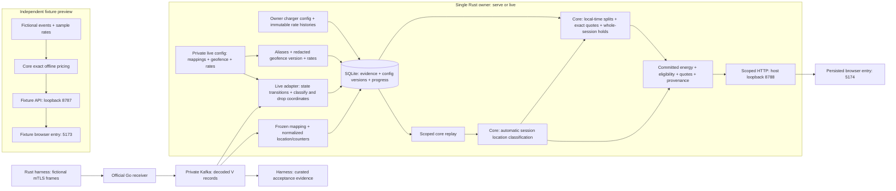

# Architecture and domain contract

ChargeShare provides exact offline pricing, a synthetic local receiver/Kafka
harness, durable Rust ingestion, a scoped browser view and an opt-in live adapter.
Ingestion, persisted viewing, automatic location classification and derived
time-of-use pricing are implemented. No live vehicle, account or production
service is connected. Setup and checks are in [README](../README.md); contributor
rules are in [AGENTS](../AGENTS.md) and [code design](code-design.md).

## Components

| Component | Responsibility |
| --- | --- |
| `chargeshare-core` | Rust domain: scoped replay, exact energy/money and local-time sample pricing |
| `chargeshare-ingestion` | Synthetic normalization and live state adaptation, Kafka consumption, SQLite transactions/recovery and committed scoped HTTP results |
| `chargeshare-harness` | Rust sender/verifier for finite fictional receiver traffic; requires protocol ACKs and matching new Kafka records |
| `chargeshare-preview` | Independent Rust fixture API with core-calculated sample prices |
| `apps/web` | React/TypeScript and shadcn; separate persisted and fixture entries/bundles, shared visual components |
| External receiver and Kafka | Pinned official Go Fleet Telemetry receiver and private single-broker synthetic transport |
| `scripts/dev` and Tilt | Owned startup, readiness, source epochs, finite acceptance, shutdown and explicit reset |

Domain dependencies point inward to the core. Receiver decoding, SQL, HTTP and
UI formatting stay outside it; money calculations stay in Rust. The official
receiver remains external Go code, with immutable inputs in
[`dev/upstream-pins.json`](../dev/upstream-pins.json).

## Architecture at a glance

Arrows show evidence/result flow. Solid arrows describe implemented paths.



One long-lived ingestion process owns one SQLite Store. It ingests and commits,
then serves requests between transactions. Each response replays one committed
snapshot; summary and session details agree. HTTP requests never reopen the
database. Bounded CLI consumers/replayers are for use while this owner is stopped,
and concurrent writers are refused.

## Ports and boundaries

All published application listeners bind IPv4 host loopback. Synthetic Kafka has
no host listener; live mode connects to an already configured broker.

| Endpoint | Boundary |
| --- | --- |
| `http://127.0.0.1:5174` | Persisted dashboard; Vite proxies only `/api/poc` to 8788 |
| `http://127.0.0.1:8788` | Sole ingestion owner's scoped results/readiness API |
| `http://127.0.0.1:5173` | Independent fixture dashboard |
| `http://127.0.0.1:8787/api/demo` | Fixture-only Rust API |
| `https://127.0.0.1:8443` | Receiver mTLS transport; container port 4443 |
| `http://127.0.0.1:10350` | Tilt resource UI |
| `kafka:9092` | Private Compose network only |

The owner binds `0.0.0.0:8788` only inside the reviewed private container, published
as host `127.0.0.1:8788`. It runs as the current user with a read-only binary,
libraries and container filesystem; only owned `.local-runtime/` is writable.
The Compose bridge and synthetic owner/vehicle checks are development boundaries,
not production authentication or permission for cross-owner sharing.

`GET /api/poc/owners/{owner}/vehicles/{vehicle}/results` requires a configured
pair of validated aliases. Malformed scopes return 400, unknown/mismatched scopes
404, unsupported methods 405, and unavailable results 503. Errors never echo
rejected values. `/api/poc/ready` reports readiness separately from acceptance.
`GET /api/poc/scopes` returns only configured owner/vehicle aliases and a
`synthetic_only` flag. The browser discovers these aliases before requesting
results; failed discovery clears the available view and retries on refresh.
There are no aggregate, mutation or pricing endpoints in this API.

Responses contain aliases, exact six-decimal observed/eligible/priced kWh, sessions,
exact quotes and once-rounded scoped subtotals, quality/exclusion and rate-hold
reasons, mode-specific measurement labels and explicit estimate boundaries, allowlisted rate/time provenance
and a deterministic semantic revision. Revisions reflect visible domain results
and provenance, not requests or redelivery; they are not cryptographic tokens.
No coordinates, raw payload, device identity, credentials, paths, offsets or logs
are served. Session results include `SharedCharger`, `OtherCharger` or `Held` and
`InsideGeofence`, `OutsideGeofence`, `LocationUnavailable` or `LocationAmbiguous`.
The overall state is empty, eligible when every session is eligible, or held when
any session remains held or excluded. Results provenance identifies the loaded
geofence version; classification reasons are separate from evidence quality.

The persisted UI separates empty, complete zero, incomplete/held, refused and
unavailable states. Scope changes hide prior results; failed reads clear them.
It presents returned exact cost, display amount, rate and interval strings without
browser money arithmetic. It never falls back to fixture data or claims an amount
owed. A missing quote has no fabricated zero subtotal; a complete eligible zero
session has a zero quote. Rate-held counts and reasons remain visible. Browser
requests time out after five seconds and repeat every ten seconds.
Broker/source/storage failures latch the owner unavailable until repaired and
restarted. HTTP reads/writes and broker verification have bounded deadlines.

## Durable ingestion and recovery

[`dev/fixtures/`](../dev/fixtures/) contains finite fictional binary
frames, exact ACK bytes and expected decoded Kafka multisets for complete,
missing, duplicate and reordered traffic. Frames use official helpers from the
pinned receiver revision; names and battery readings remain fixture context.
The verifier takes starting offsets before sending, so retained traffic cannot
satisfy a fresh run. ACK alone never proves the downstream result. After matching
observed records, the harness retains curated normalized evidence for complete
sessions using the ingestion normalizer, preserving one field-validation policy.
Its publication summaries omit location fields, and replay metadata
contains scenario identity, counts and starting offsets rather than raw payloads.

[`dev/ingestion-manifest.json`](../dev/ingestion-manifest.json) freezes fictional
device/owner/vehicle associations and maps observed source moments to explicit
Start/Sample/End, connection, position and AC annotations. An annotation creates
no event without its observed record and contains no expected energy counter.
Charging-complete state and silence never invent an End.

The versioned normalizer accepts `VehicleName`, `BatteryLevel`,
`DetailedChargeState`, `ACChargingEnergyIn` and `Location` in the inspected V envelope.
Names and battery values are discarded; counters come only from observed strings.
Missing counters remain absent, invalid counters retain safe reasons, and
unsupported/duplicate fields reject safely. Integral UTC `createdAt` becomes
signed Unix seconds; Kafka's zero timestamp header is not event time. Mapping,
input, normalizer and time-conversion versions are frozen with the database.
`Location.locationValue` supplies latitude and longitude. Finite coordinates in
latitude ±90° and longitude ±180° are normalized to canonical decimal strings
with signed zero removed. Malformed, duplicate-coordinate, out-of-range and invalid
location values retain only an invalid state; missing location stays absent.
Other receiver fields remain strictly allowlisted. Raw location payloads and
rejected coordinate text are discarded. Diagnostics redact points, and coordinates
never enter API responses, browser bundles, application logs or acceptance output.

The manifest configures an owner charger with a stable charger ID, synthetic
geofence and selected rate-version IDs. Vehicle registration selects its owner
and that owner's charger; shared physical charger IDs and rate histories do not
merge owner ledgers. Geofences remain owner-scoped under a separate geofence
version. Legacy geofence-only manifests remain readable with no selected rates.
The Rust core uses great-circle haversine distance on a sphere with mean radius
6,371,008.8 m. The radius is inclusive, with a 10 nm numerical rounding allowance;
this computation makes no claim about physical positioning accuracy.
Every retained logical session position contributes location evidence. All inside
means `SharedCharger`; all outside means `OtherCharger`. No valid samples means
`Held` / `LocationUnavailable`; partial coverage, mixed locations or conflicting
evidence means `Held` / `LocationAmbiguous`. A later valid sample can enrich the
same otherwise-identical missing/invalid event without duplicating energy or
boundaries. Distinct valid points at the same position remain conflicts.

Classification is derived on replay, without stored per-session decisions,
review controls, overrides or a classify API. Loading a new geofence version on
owner startup automatically replays every affected retained session using that
config. Previously loaded versions retain immutable normalized config; changing
content under a reused version refuses recovery. Geofence and charger/rate
selection can change
through startup configuration; source bindings, mappings, annotations and
normalization/time contracts stay frozen. Schema-one and schema-two datasets
migrate transactionally to schema three without removing evidence or progress.
Absent locations yield an automatic hold.

SQLite stores curated variants or fixed rejection reasons, provenance and next
partition positions in one transaction using WAL, FULL synchronization, foreign
keys and a bounded busy timeout. Exact counters and unsigned positions use
canonical decimal TEXT. Arbitrary raw JSON and rejected text are not stored.
SQLite is the sole recovery-position authority; automatic Kafka commits and
offset storage are disabled. Rollback changes neither evidence nor progress;
interrupted commits recover consistent old-or-new state. Redelivery is idempotent,
while conflicting domain variants are preserved for conservative core replay.

An owned Kafka volume label and private `source-epoch.json` bind the dataset to
its epoch, topic, cluster, partition and initial offset. Ordinary restart/down
preserve the pair and SQLite. Missing/mismatched identity, frozen configuration
changes or retained-offset gaps refuse recovery, preserving evidence. Recovery
never seeks latest or silently resets. Bounded reread checks already committed,
still-retained ranges without changing evidence or progress.

`poc.sh up` starts services without sending fixtures; `check` sends fresh traffic
and checks Kafka, committed SQLite, scoped HTTP and the browser entry. Lifecycle
commands serialize under a private lock. Only confirmed reset of stopped, owned
synthetic state removes the runtime and broker volume; it never prunes Docker.
The shared `scripts/dev/acceptance.sh all` owns its fresh runtime and teardown and
refuses preexisting state. It checks transport, recovery, reread, refusals and
viewing. Commands and CI entry points are in [README](../README.md#tests).

Private ignored runtime directories hold generated test trust, locks, SQLite and
companions; `.cache/` holds local tooling state. No-follow handles and ownership
checks reject unsafe files. These guarantees assume trusted local Linux/Docker
and no hostile process with the same UID; they do not establish backups,
replicated-broker availability or cloud durability. Captures, logs, keys and
databases stay private; only allowlisted synthetic summaries may be published.

### Live adapter

The approved [#49](https://github.com/jestrada/ChargeShare/issues/49) adapter uses
the existing receiver's decoded `<topic_namespace>_V` records without fixture
annotations. Start the ingestion owner and persisted dashboard together from
the repository root with a private configuration path:

```sh
python3 scripts/dev/live.py --config /home/box/.config/chargeshare/live.json
```

The command binds the API to `127.0.0.1:8788` and the dashboard to
`127.0.0.1:5174`, and stops its child process groups when either service exits
or the command is interrupted. It requires the Rust/Node tools and installed web
dependencies. Receiver provisioning, vehicle registration, OAuth, pairing,
deployment and vehicle control remain separate requests.

Configuration must be an absolute, nonsymlinked private file outside the checkout,
owned by the current user with a private parent directory. Use mode `0600` for
the file and `0700` for its parent and database directory; the absolute
SQLite path also stays outside the checkout. The configuration selects Kafka
bootstrap servers, topic namespace, a stable `live-` source epoch, device-to-alias
mappings, one shared charger geofence and the existing explicit rate models.
[`dev/live-config.example.json`](../dev/live-config.example.json) contains only
fictional identifiers, coordinates, paths and labeled public sample rates.
No private configuration is copied into this repository.

`live` owns decoded-field parsing and vehicle state adaptation; the core owns
location distance, conservative reconstruction and exact energy/pricing policy.
`DetailedChargeState` transitions from a known noncharging state to Charging
provide Start. Complete, Stopped or Disconnected while a connection is open
provide End. Starting mid-charge retains samples with a missing-start hold.
Silence, zero power and sparse counters create no End. `createdAt` supplies
integral UTC event time; arrival time and the zero timestamp header do not.
Late or unknown-state records remain conservative ambiguous evidence.

Energy uses only observed `ACChargingEnergyIn` counter deltas. Positive
`ACChargingPower` or a valid AC counter establishes AC evidence; power and elapsed
time never supply energy. A missing final counter leaves the session held with
`MissingTerminalSample`, preserving earlier observed deltas. Live results label
this boundary as vehicle-reported AC input counter energy with unvalidated
physical accuracy, and retain the existing pricing estimate boundary.

Only `DetailedChargeState`, `ACChargingEnergyIn`, `ACChargingPower` and `Location`
affect adaptation. Unknown telemetry fields, including ChargeState, Odometer and
Soc, are ignored and discarded while the record is processed. Duplicate consumed
fields and malformed envelopes reject with fixed reasons. Coordinates are
validated and classified against the private geofence, then dropped before any
SQLite write, logging or API response. Storage retains only inside/outside,
invalid or absent location evidence and aliases; device identity, raw transaction
IDs and the geofence center never persist. Mapping/geofence fingerprints freeze
the live configuration because dropped coordinates cannot be reclassified under
a changed geofence; configuration changes refuse reuse of that dataset.

Per-vehicle transaction fingerprints deduplicate receiver redelivery and resends.
Identical normalized signals also reuse the original disposition and position.
Changed signals under a reused transaction identity refuse ingestion. Adapter
state, curated evidence, deduplication checkpoints and the next partition offset
commit together in one SQLite transaction. Restart resumes the same session and
positions. A private source marker binds the live dataset to its epoch, topic,
cluster and initial partition offsets; expired history or changed source identity
refuses recovery. Live mode reuses the single SQLite owner, committed snapshot
API and existing browser pricing contract.

## Implemented offline ledger

### Core module ownership

Location validation and distance live in `location`; automatic classification lives
with session reconstruction in `session`. Neither depends on the ledger or IO.

The small [public facade](../crates/chargeshare-core/src/lib.rs) explicitly exports
types from cohesive private modules: `energy`, `identity`, `event`, `session`,
`ledger`, `location`, `error`, `money`, `tariff`, `pricing` and `time_of_use`.
Domain imports are acyclic and never depend on adapters. Extra layers, generic repositories and service splits
need a concrete approved use case; current orchestration stays in Ledger and the
outer ingestion crate. [Code design](code-design.md) describes the design workflow.

Owner, vehicle, connection and tariff-version aliases accept 1–64 ASCII letters,
digits, underscores or hyphens. A vehicle has exactly one owner. Every read requires
vehicle scope; wrong-scope requests refuse without mutation.
Automatic classification selects configuration by the vehicle’s registered owner.
Session identity is `(vehicle, connection)` and positions are vehicle-wide. Connection aliases must not be reused for another connection.

Energy is checked integer arithmetic with six decimal kWh places. Signs,
whitespace, exponents, non-finite values and excess precision reject; arithmetic
overflow fails explicitly. The independent offline preview keeps signed synthetic
ticks. Persisted evidence uses integral UTC epoch seconds and the selected sample's
explicit local timezone.

Replay partitions by vehicle before deduplication and orders by `(time, position)`.
Identical repeats are no-ops. Different payloads at the same position remain
conflicts; no candidate is selected as a measurement or boundary. Conflict,
invalid-counter and non-AC barriers break the counter chain. Deltas never cross
connections; rollback adds no negative energy and holds the session.

Start/End require explicit evidence and baseline/terminal samples. Pause/resume
stay in the same connection. Missing boundaries/readings, malformed ordering,
rollback and conflicting evidence retain visible quality flags. Silence means
neither zero consumption nor a session end. Only complete, uncontested AC sessions
classified `SharedCharger` are eligible; `OtherCharger` and automatic location
holds are excluded. Classification cannot clear quality flags or DC/ambiguous exclusions.
The same automatic policy supplies offline and persisted eligibility. Location
cannot make incomplete, conflicting, DC or ambiguous charge-type evidence eligible.

### Exact offline pricing

USD rates have ten decimal places; exact energy × rate costs have sixteen.
Checked sums aggregate exact costs before one half-up rounding to cents. Versioned
rate windows are immutable, half-open and non-overlapping; gaps are permitted.
Every positive counter interval must fit wholly within one window. Missing rates,
cross-window intervals or non-increasing time hold the entire session, preserving
observed energy and other exclusions. No split is invented by interpolation.
A complete eligible zero-energy session needs no rate window.

Priced subtotals include only fully quoted sessions, with holds visible beside
them; they are not an amount owed. The fixture adapter supplies a date-bounded
September public EV2-A sample and a separately labeled winter estimate from
[`rates.rs`](../crates/chargeshare-preview/src/rates.rs). It borrows no rate across
missing coverage. Fixture dates/ticks do not implement timezone, DST or utility
calendars. Fixed fees, taxes and statements remain outside quotes.

### Persisted time-of-use pricing

The existing scoped result replay also derives prices through the core's
`time_of_use` module. Its concrete immutable history and named local periods use
existing `Energy`, `UsdRate`, `ExactUsd` and `UsdCents`; SQL/config DTOs stay in
ingestion. There is no pricing endpoint, quote storage or mutation UI. SQLite
retains immutable rate definitions separately from the startup-selected histories.
Reusing a version ID with changed contents refuses startup before evidence or
progress changes. A new selected version changes quotes, provenance and semantic
revision while preserving session identity, evidence, classification and quality.

The active labeled PG&E bundled EV2-A sample is Advice 7846-E, effective
2026-03-01, in `America/Los_Angeles`. Summer is June through September and winter
October through May. Named periods apply every day, including weekends/holidays:
off-peak 00:00–15:00, part-peak 15:00–16:00 and 21:00–24:00, peak 16:00–21:00.
Rates, source and half-open effective local dates are versioned configuration.
The bounded period list supports multiple named periods. Overlapping periods or
selected effective dates, invalid exact rates and incompatible calendar/timezone
rules refuse configuration. Missing coverage is a session hold. Holiday dates
label provenance under `all-days-v1`; they do not change prices.

`chrono` and `chrono-tz` supply calendar conversion and an embedded IANA timezone
version, avoiding host clock/calendar dependence and handwritten DST rules.
The selected timezone-rule version must match the compiled database. This is the
small dependency needed for actual civil-time resolution; domain policy still has
no infrastructure dependency. The current calendar policy is the approved
June–September season and all-day PG&E sample schedule, not a general utility
calendar engine.

Each adjacent valid AC counter pair is split at local period edges, midnight,
season/effective-date changes and actual UTC offset transitions. Bounds are
half-open. Repeated wall times resolve to their distinct UTC instants; nonexistent
spring wall times add no elapsed seconds. Integer micro-kWh shares use elapsed
UTC seconds, floor each exact ratio, then assign remainders by largest fraction
with earlier slices winning ties. This conserves each observed delta and discloses
linear allocation as an estimate, including long counter gaps; no maximum-gap
hold or extra energy is inferred. Missing coverage, non-increasing times or an
unresolved boundary holds the entire quote; no partial cost escapes. Complete
eligible zero energy requires no rate. Automatic #22 classification and AC/evidence
quality remain the eligibility authority.

Slices return UTC epoch bounds, local timestamp bounds with offsets, local date,
season/day/period, selected
model ID, allocated AC energy and exact rate/cost. The scoped response also returns
charger/model/source/effective-date and timezone/calendar/calculation provenance.
Checked exact slice costs form session costs and scoped subtotals, rounded half-up
to cents once; displayed session cents are never summed in the browser. Overflow
refuses the result with a typed error. The estimate excludes CCA/PCIA, baseline
credit, daily Base Services Charge and taxes and is not a bill.

## Measurement boundary

Every total identifies synthetic evidence and its AC counter boundary and quality.
AC-input energy and battery-added energy have different measurement boundaries.
Neither synthetic transport nor exact arithmetic proves utility-meter accuracy.
Before any separately approved real trial, validate firmware/signals, counter
resets, latency, boundaries and final samples against an agreed independent
reference where permitted. Do not add a generic charging-loss multiplier or
infer energy from battery percentage or a last power reading across gaps.

## Key decisions and next increments

- [#22](https://github.com/jestrada/ChargeShare/issues/22): automatic classification
  runs inside the Rust core from normalized session location and owner-scoped,
  versioned geofences. Retained inputs support restart and reclassification;
  only otherwise-eligible AC `SharedCharger` energy crosses the pricing boundary.
  There is no manual per-session classification path or coordinate display.
- [#23](https://github.com/jestrada/ChargeShare/issues/23): startup-selected immutable
  EV2-A rates price committed eligible sessions in the core; the persisted UI
  presents returned amounts, provenance and whole-session hold reasons.
- Live transport, production authentication/sharing, privacy/retention and hosting
  need separate approval and contracts. Enforce any live ingress allowlist before
  sinks, payload logs or persistence; preserve receiver mTLS authentication.
  Registration, OAuth, key pairing, deployment, spending and vehicle controls
  remain outside the synthetic runtime.
- GitHub issues own scope, checklists and acceptance evidence. Test results
  and run logs belong in the owning issue or PR, never this document.

Required upstream notices remain in [`licenses/`](licenses/): receiver Apache 2.0,
shadcn/Matt Pocock skills MIT and Geist OFL. Bundled frontend notices live
in `apps/web/public/licenses/`. Receiver builds also preserve native dependency
notices (libsodium ISC and libzmq LGPL with its linking exception). Repository
data and publication safeguards are in [SECURITY](../SECURITY.md).
