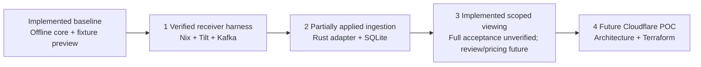

# ChargeShare proof of concept plan

Build three synthetic local stages, then validate Cloudflare using Terraform.
Each needs reviewed acceptance; this roadmap authorizes no implementation,
deployment, credentials, spending or vehicle access.

Offline ledger/pricing, fixture preview and stage 1's synthetic receiver/Kafka
harness are implemented and verified. Stage 2 has independently tested candidate
normalization, SQLite recovery and mocked Kafka replay. Closed issue #27 records
predecessor receiver-backed acceptance on `40d97de` locally and `1d0d118` hosted.
Issue #21 implements scoped persisted viewing with focused HTTP/process tests;
its full receiver-backed viewing, hosted and browser acceptance remain unverified. Persisted reviews/pricing and Cloudflare need separate changes. See [architecture](architecture.md), [pricing](pricing.md) and
[local preview](local-preview.md) for existing behavior.

Current planning follows the [Wayfinder map](https://github.com/jestrada/ChargeShare/issues/9).
The [durable ingestion acceptance issue](https://github.com/jestrada/ChargeShare/issues/12)
tracks the remaining work in the existing ingestion PR. OpenSpec is paused;
linked artifacts below remain reference material. Track current scope, tasks and
acceptance evidence in GitHub Issues and PRs through `gh`.

## Route to a working POC

Arrows show milestone order. Local stages target Linux x86_64 with permitted
Docker, including private cloud hosts. Cloudflare follows working local stages;
Linux success establishes no Cloudflare compatibility.

Keep scoped, exact results across replay/restart; show missing/conflicting
evidence as holds. Synthetic results establish no real bill or meter accuracy.

## Ownership

| Component | Owner / ChargeShare responsibility |
| --- | --- |
| Official receiver / dispatcher | Tesla; pin and configure, preserve upstream transport. |
| Synthetic client | Upstream helpers; adapt finite fictional fixtures. |
| Kafka | Apache; configure retained handoff, no managed provider selected. |
| SQLite | Upstream; own schema, migrations, transactions and lifecycle. |
| Rust integration / core / API / dashboard | ChargeShare; normalize, replay, price and present scoped evidence. |
| Cloudflare / Terraform provider | Upstream; review topology and versioned infrastructure. |

Transport, storage and presentation stay outside the pure Rust core. Receiver
ACK and decoded records do not establish an accepted ledger event or database
commit. Existing behavior is documented in [architecture](architecture.md),
[pricing](pricing.md) and [local preview](local-preview.md).

## Stage 1 Receiver transport harness

Completed and archived on 2026-10-10: [proposal](../openspec/changes/archive/2026-10-10-local-nix-tilt-kafka-harness/proposal.md),
[design](../openspec/changes/archive/2026-10-10-local-nix-tilt-kafka-harness/design.md),
[tasks and evidence](../openspec/changes/archive/2026-10-10-local-nix-tilt-kafka-harness/tasks.md).
Canonical contracts are [local development](../openspec/specs/local-development/spec.md)
and [synthetic telemetry harness](../openspec/specs/synthetic-telemetry-harness/spec.md).
[Testing](testing.md) records complete fresh Linux acceptance, failure proof,
retained restart/reset and cache timings.

Pinned Nix/Tilt/Compose manages receiver, Kafka and separate fixture preview.
**Acceptance:** Fresh Linux protocol readiness, finite mTLS WebSocket exchange,
ACK **and** matching decoded Kafka fields within deadlines. Reject invalid
trust/stale matches; verify stop/reset. The fresh `ubuntu-24.04` gate fails
setup/assertions/timeouts, cleans up and retains safe diagnostics. ACK-only/direct
injection cannot pass. Ingestion, persistence and telemetry-backed results remain
outside stage 1.

## Stage 2 Durable Rust ingestion

**Status:** Implemented and merged in [PR #6](https://github.com/jestrada/ChargeShare/pull/6),
with the #27 follow-up merged in [PR #28](https://github.com/jestrada/ChargeShare/pull/28).
The current #21 checkout starts at merged main `ceb74b1`.
The retained [durable ingestion proposal](../openspec/changes/durable-synthetic-ingestion/proposal.md), [design](../openspec/changes/durable-synthetic-ingestion/design.md),
[detailed contract](../openspec/changes/durable-synthetic-ingestion/specs/durable-telemetry-ingestion/spec.md)
and [tasks](../openspec/changes/durable-synthetic-ingestion/tasks.md) preserve the original approved scope and recorded status.
The [ingestion acceptance issue](https://github.com/jestrada/ChargeShare/issues/27)
owns the current checklist and evidence. Candidate normalization,
atomic SQLite evidence/progress and scoped replay have focused tests; see the
[implementation guide](durable-ingestion.md). Stage 1's published head `33a4568`
has verified receiver/Kafka transport, retained replay, restart/reset and cleanup.
The owned broker epoch lifecycle and actual receiver-backed ingestion remain
prerequisites for stage-2 end-to-end acceptance.

The outer Rust consumer/normalizer implements configured synthetic identity mapping,
evidence retention, SQLite schema, deduplication, late/conflicting messages and
transactional consumer progress under the reviewed spec.
Keep upstream payload types and database details out of the core. Decide how
retained transport evidence reconstructs the domain's explicit session boundaries
without inventing samples or treating silence as completion. The proposed local
synthetic manifest supplies explicit connection/position/boundary annotations
that receiver records do not provide; it does not establish real vehicle
boundary semantics. Stage 2 retains observed evidence and defaults reconstructed
sessions to unconfirmed. Persisted review decisions and results remain stage 3.

**Acceptance:** Fixed multi-vehicle records map into valid scoped core events;
duplicates and reordered/late input replay deterministically without double
counting. Missing, invalid and conflicting readings remain visible. Demonstrate
reconnect and restart at transaction/consumer-progress boundaries, including a
crash between reading and committing, with no lost accepted evidence or inflated
energy. Review safe diagnostics and unknown-identity rejection.

**Boundary:** Durable synthetic ingestion and replay only. Production allowlists,
real telemetry retention, account authentication and vehicle provisioning need
their own reviewed contracts before any live input.

## Stage 3 Persisted charging results

Issue [#21](https://github.com/jestrada/ChargeShare/issues/21) implements the viewing
slice: one Rust ingestion/SQLite/HTTP owner and a dedicated persisted frontend
mode at 5174/8788. Reuse core session/summary policy, expose observed AC,
Unconfirmed and conservative eligibility holds, and keep fixture mode independent.
[The contract and exact acceptance checklist](persisted-viewing.md) describe
implementation, proof limits and reviewer commands. Actual full-path acceptance,
clean hosted gate and desktop/mobile screenshots remain unverified here.

Deliberate persisted charger review belongs to
[#22](https://github.com/jestrada/ChargeShare/issues/22); immutable sample rates and
exact persisted pricing belong to [#23](https://github.com/jestrada/ChargeShare/issues/23).
Neither is implemented in viewing. Money arithmetic remains in Rust.

**Acceptance:** Fresh receiver → Kafka → sole owner → committed SQLite → scoped
HTTP and browser evidence, including replay/restart/crash and concurrent reads.
Missing/conflicting evidence stays held; complete zero evidence is distinct from
empty/unavailable. Mismatched scope refuses safely. The shared command keeps all
#27 phases and adds actual HTTP viewing. Local setup/assertion/timeout proofs
followed by a restored local pass satisfy Joseph's failure-proof decision; no
hosted deliberately failing run is required. Clean hosted viewing and manual
network-response/screenshot comparison still apply. Real utility calendars,
bills, payments, authentication and cross-owner sharing stay outside this slice.

## Stage 4 Cloudflare architecture and Terraform deployment

After local success, propose architecture/security and deployment separately.
Validate the actual runtime first:

- Image/CPU support, lifecycle, resource limits and cold starts
- WebSocket/mTLS ingress preserving authenticated client-certificate identity
- Private broker/consumer connectivity and access control
- Durable evidence, offsets and SQLite/storage recovery; local disk is not assumed durable
- Private authenticated UI/API, scope, secrets, observability, retention, costs and rollback

Pin Terraform/provider versions and review the plan before apply. Verify provider
resource support; document application/image deployment separately. Keep protected
state and credentials outside this public repository.

**Acceptance:** After explicit deployment authorization, exercise actual Cloudflare
ingress and the complete persisted path: ACK, correct scoped results, rejection
and platform restart/recovery. Verify repeatable Terraform configuration, safe
rollback and agreed resource/cost limits. Resolve unsupported ingress/storage
before completion. This remains synthetic; live Tesla setup and accuracy or
reimbursement validation need separate authorization.

## Review and evidence

Link issues and PRs; record exact commits, pins, acceptance and unsupported
cases. Review and verify the approved acceptance before an authorized merge. Official upstream
guidance establishes no executed compatibility or chosen Cloudflare topology.
